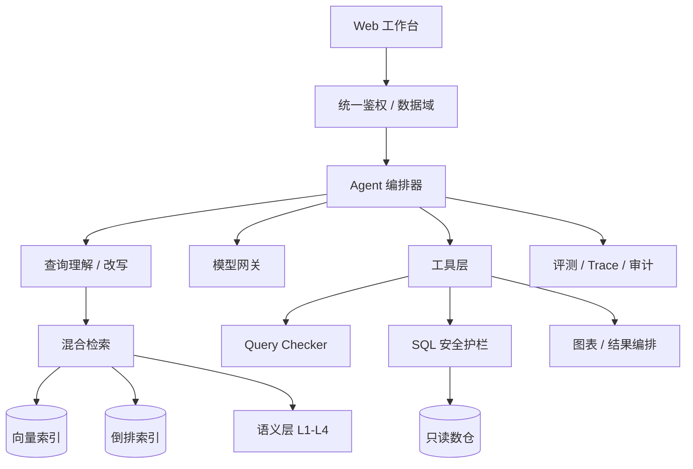
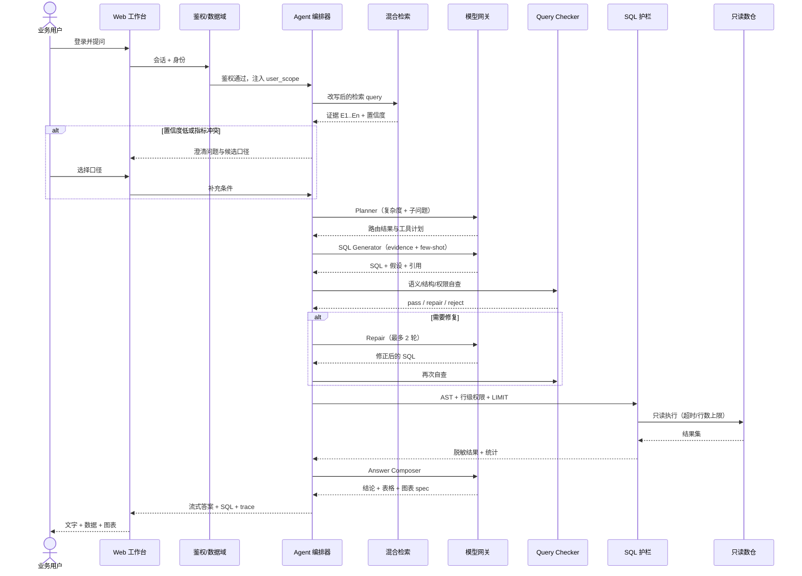
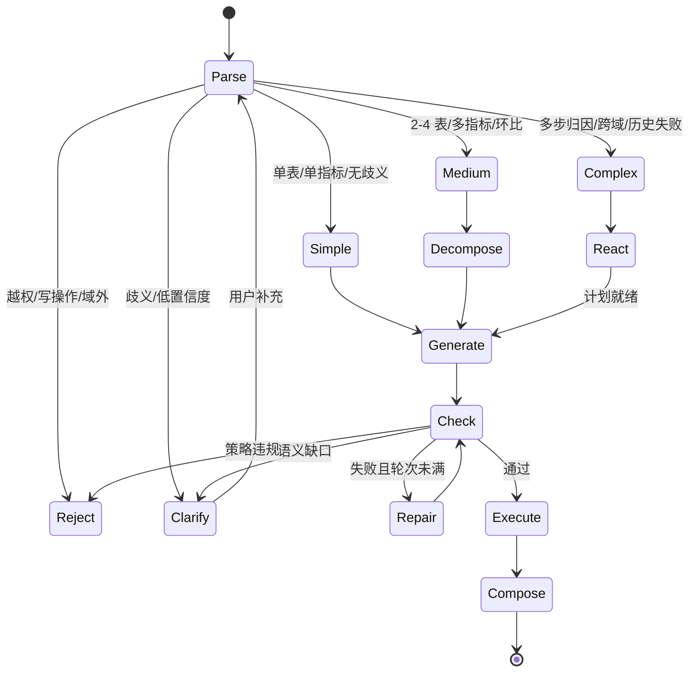

# 智能问数 Agent 架构说明

本文说明智能问数 Agent 架构。生产系统部署于招商金科内部，本文已脱敏；代码、表结构与真实数据不对外，演示为模拟数据。

## 1. 设计原则

1. **证据先于生成**：模型只能基于检索到的表、字段、指标、业务说明生成 SQL，不许凭记忆编表。
2. **确定性优先**：权限、只读、LIMIT、AST 用代码实现，不靠 Prompt 许愿。
3. **按复杂度付费**：简单问题不走 Agent Loop，把时延和 token 留给复杂分析。
4. **失败可解释**：检索、路由、校验、修复都写 trace，出错能定位到环节。
5. **评测驱动迭代**：Prompt、模型、语义卡变更都跑同一套回归。

## 2. 整体架构



| 组件 | 职责 | 关键实现 |
| --- | --- | --- |
| Web 工作台 | 对话、追问、结果与 trace 展示 | 流式输出；SQL 折叠；图表渲染 |
| 鉴权/数据域 | 身份、组织、角色、数据域 | SSO；请求注入 `user_scope`；会话隔离 |
| Agent 编排器 | 路由、计划、工具调用、状态机 | 规则特征 + 模型判定；最大轮次与超时 |
| 语义层 | 表/字段/指标/同义词/关系/脏数据 | 四层资产，版本化，指标平台为权威源 |
| 混合检索 | 召回与重排 | 向量 + 倒排，RRF 融合，重排取 top-k |
| 模型网关 | 统一模型调用、降级、计费 | 超时、重试、模型切换、token 统计 |
| 工具层 | 检索、校验、执行、图表 | 工具白名单；参数 schema 校验 |
| 安全护栏 | AST、权限、LIMIT、脱敏 | 解析后拒绝；执行前重写；只读账号兜底 |
| 评测/审计 | 回归、归因、留痕 | 评测集版本化；trace 与审计分离存储 |

## 3. 一次问数的完整时序



关键点：澄清在 SQL 生成前，避免先算错再解释；Checker 偏语义、护栏偏安全，两层都过才执行；结果先脱敏再交给 Composer；trace 记录输入摘要、耗时、证据 ID 与决策原因。

## 4. 复杂度路由状态机



路由优先使用可解释特征，模型只处理边界样本：

| 特征 | 简单 | 中等 | 复杂 |
| --- | --- | --- | --- |
| 涉及表数 | 1 | 2—4 | ≥5 或跨域 |
| 指标数 | 1 | 2—4 | 多指标+归因 |
| join | 无或 1 个 | 2—3 个 | 多跳/桥表 |
| 语言信号 | 查/是多少 | 环比/对比/分组 | 为什么/拆解/下钻 |
| 历史失败 | 无 | 无 | 同题失败过 |
| 处理 | few-shot 单轮 | Decomposition + CoT | ReAct Loop |

预算：简单 1 次模型调用、1 次 SQL；中等 2—4 个子问题；复杂最多 4 轮、6 次工具调用、45 秒墙钟、2 次 Repair。超预算即降级，不无限试。

## 5. Schema Linking

Schema Linking 决定「找不找得到正确的数」，比换模型更影响正确率。流程：

1. **归一化**：把「上个月」「近 30 天」「Q1」转成明确区间；渠道简称、机构别名、指标别名映射到标准名，保留原表述用于回显。
2. **表级召回**：向量 top 30 + 倒排 top 30，合并去重；按表名、注释、业务说明、历史频次加权。
3. **字段/指标召回**：候选表内打分，优先指标平台字段、主外键、时间分区、常用维度；敏感字段单独标记。
4. **关系扩展与剪枝**：join 图 2 跳扩展，识别桥表与多对多，校验粒度防止订单级 join 保单级导致金额翻倍；最多 6 表、40 字段，以覆盖指标公式为约束去掉低分表。
5. **置信与澄清**：综合检索分、重排分、join 完整性、指标唯一性输出置信度；高置信自动生成，中置信展示假设，低置信澄清或拒答。

输出是结构化 `SchemaEvidence`：表、字段、指标、join、同义词、粒度、脏数据提示、敏感级别、截止时间。SQL 必须引用这些 ID，Composer 也要用它们解释口径。

## 6. 四层数据准备

| 层级 | 解决什么 | 典型产物 | 缺失后的表现 |
| --- | --- | --- | --- |
| L1 元数据 + 字段语义 + 脏数据说明 | 表/字段是什么、能不能用 | 表卡、字段卡、枚举、空值率、异常说明 | 选错字段、把编码当名称、被脏数据误导 |
| L2 表关系 + 编码对齐 | 表怎么 join、口径怎么对齐 | 关系图、join 键、桥表、渠道/机构/产品映射 | join 错、金额翻倍、机构对不上 |
| L3 业务解释 + 同义词 | 一行数据代表什么、业务怎么说 | 粒度说明、时间语义、同义词词典、常见误区 | 听不懂「保费」，把签单日当生效日 |
| L4 指标平台 + 公式知识库 | 指标唯一口径、怎么算 | 指标卡、公式、维度、排除项、版本、血缘 | 同一问题多个数，模型自创公式 |

运营规则：每张卡有 owner、版本、更新时间和验证问题；指标变更走评审并触发回归；L1 脏数据说明必须具体到「哪一列、什么表现、怎么规避」。

## 7. 混合检索与 evidence 注入

- **切分**：以语义卡为最小单元（表卡、字段卡、指标卡、同义词、问答对），不按固定长度硬切。
- **双路召回**：向量解决「说法不同但意思相近」，倒排解决「专有名词、编码、精确别名」；各取 top 30。
- **融合**：RRF（k=60）合并，权重约 0.6/0.4，轻量重排取 top 8—12；同表多卡去重 + MMR，避免证据全来自一张表。
- **注入格式**：

```text
[E1] table=dws_policy_premium_di | 粒度=保单-月 | 分区=stat_date | 负责人=…
[E2] metric=m_premium_channel | 公式=SUM(premium) | 排除=退保冲减 | 版本=v3
[E3] join=policy.policy_id = premium.policy_id | 基数=1:N | 注意=先按保单去重
[E4] synonym=保费收入 -> m_premium_channel | 签单日=issue_date | 生效日=effective_date
```

- **预算**：Schema 2500 tokens、指标 800、few-shot 1200、历史 600；超预算按分数裁剪，保留指标公式、join 键、分区字段，不裁安全约束。
- **溯源**：SQL 的表/字段、答案的口径都要能回指 `E*`；无法回指即视为幻觉信号。

## 8. SQL 生成、校验与修复

生成阶段强制 JSON 输出：`sql`、`dialect`、`used_tables`、`metric_ids`、`assumptions`、`confidence`、`citations`。Prompt 约束：不用 `SELECT *`、不写注释、不猜字段、不使用未登记函数、不跨域、不写多语句。

校验分四层：

| 层 | 检查 | 失败处理 |
| --- | --- | --- |
| 语法/结构 | 能否解析、是否单条 SELECT/CTE、括号与别名 | 修复或拒绝 |
| Schema | 表/字段是否存在、join 是否覆盖、粒度是否放大 | 补 join / 澄清 / 拒绝 |
| 语义 | 指标公式、时间边界、过滤条件、聚合完整性、除零/空值 | 修复；口径不明则澄清 |
| 策略 | 分区、LIMIT、扫描量、权限、敏感字段 | 重写或拒绝 |

有 `EXPLAIN` 时估算扫描量，超阈值要求收紧分区或拒绝；执行超时 30 秒、行数上限 1000，结果先脱敏再进 Composer。

Repair 按错误类型给最小上下文（错误、失败 SQL、相关 evidence），输出完整 SQL + 改动说明；最多 2 轮，同一错误重复即停；**不得删业务过滤或放宽时间范围来让 SQL 跑通**；权限错误不修复，直接告知申请路径。

## 9. AST 安全护栏

护栏在 SQL 字符串进入数据库之前执行，采用「解析—校验—重写—再校验」：

1. 用 AST 解析器（sqlglot）解析；解析失败直接拒绝，失败关闭（fail closed）。
2. 只允许单条 `SELECT` / `WITH` / `UNION`；拒绝 `INSERT`、`UPDATE`、`DELETE`、`DROP`、`ALTER`、`TRUNCATE`、`CREATE`、`GRANT`、`CALL`、`EXEC`。
3. 拒绝多语句、注释拼接、`INTO OUTFILE`、`LOAD DATA`、系统库/系统表、危险函数（如 `sleep`、`benchmark`）。
4. 强制注入行级组织过滤；分区表必须带分区条件；外层自动包 LIMIT（默认 1000）。
5. 结果层再做列级权限与脱敏；手机号、身份证、姓名、地址默认掩码，日志只记 SQL 哈希与行数；数据库用只读账号、独立连接池、超时与最大扫描量兜底。

安全不依赖模型「听话」：Prompt 只是提示，AST 和只读账号才是边界。

## 10. 结果展示

结果编排遵循「结论先行」：

- 先一句话回答，再给关键数字、表格、图表、口径与假设，SQL 默认折叠。
- 图表选型规则化：时间趋势折线、类别对比柱状、占比饼图（≤6 类）、单值 KPI、分布直方图；类别 >12 回退表格。
- 数字只来自结果集，展示单位、时间范围、截止时间；空结果、低置信、口径冲突显式提示。
- 不把相关写成因果；归因只给「相关维度 + 下钻建议」并标注局限。

## 11. 评测集与归因

评测集分层：简单、中等、复杂、歧义、空结果、越权/攻击、脏数据；每题含问题、标准 SQL、标准结果、资产、难度、版本，业务与数据开发双人标注、争议复核。

核心指标：execution accuracy（结果一致）、valid SQL rate（可执行）、clarification accuracy（澄清是否选对）、safety interception（拦截率）、P50/P95、单题成本。发布门禁：正确率 ≥85%，较上版降幅 ≤2 个百分点，安全用例 100%，P95 不退化。

错误归因树：

| 类型 | 典型表现 | 优先修复 |
| --- | --- | --- |
| 检索漏召 | 正确表没进候选 | 同义词、表卡、召回权重 |
| Schema Linking | 选错表/字段、join 路径错 | 关系图、粒度说明、重排 |
| 指标口径 | 公式或排除项错 | 指标卡、澄清、指标平台对齐 |
| 时间/过滤 | 区间边界、分区错 | 时间归一化、分区规则 |
| 聚合/粒度 | 金额翻倍、去重错 | 粒度校验、join 基数提示 |
| SQL/方言 | 函数不支持、语法错 | Prompt、Repair、方言配置 |
| 展示 | 图表误导、单位错 | 选型规则、Composer 约束 |

线上信号（点赞/点踩、复制、导出、重复改写、转人工）进入周度归因，与离线评测交叉验证；只看均值会被骗。

## 12. 数据模型

| 实体 | 关键字段 | 说明 |
| --- | --- | --- |
| `query_session` | id, user_id, org_scope, created_at | 会话与数据域绑定 |
| `query_turn` | id, session_id, question, route, status, latency_ms | 一次提问与路由结果 |
| `semantic_asset` | id, type, name, layer, owner, version, sensitivity | 表/字段/指标/同义词统一资产 |
| `metric_definition` | id, formula, dimensions, exclusions, version | 指标唯一口径 |
| `retrieval_trace` | turn_id, evidence_ids, scores, top_k | 证据与召回过程 |
| `sql_attempt` | turn_id, sql, checker_result, ast_result, exec_status, row_count | 每次生成/修复/执行 |
| `feedback` | turn_id, rating, reason, comment | 线上反馈 |
| `eval_case` | id, question, gold_sql, strata, version | 回归评测集 |
| `audit_log` | actor, action, sql_hash, decision, created_at | 安全与导出审计 |

语义资产与指标定义必须版本化；`sql_attempt` 保留每次尝试，否则无法复盘 Repair 是否在「拆东墙补西墙」。

## 13. 失败模式与降级

| 失败模式 | 检测 | 降级/处理 |
| --- | --- | --- |
| 检索无结果 | top-k 为空或分数过低 | 澄清、给候选资产、转人工；不猜 |
| 置信度低 | 低于阈值或指标冲突 | 展示候选口径，让用户选；不执行 |
| SQL 语法/语义错 | Checker 或执行报错 | 最多 2 轮 Repair；仍失败给分类与建议 |
| 空结果 | 0 行 | 判断条件过严/分区无数据/口径错，给放宽建议 |
| 查询超时 | 超时/扫描量超限 | 取消、保留 trace、建议缩小范围；不返回半截 |
| 权限不足 | 行/列/域校验失败 | 解释缺什么、如何申请；不自动提权 |
| 模型不可用 | 网关超时/限流 | 重试一次→备用模型→模板/FAQ→人工 |
| 数据延迟 | 分区未就绪/截止时间旧 | 展示新鲜度徽标；时效敏感问题提示 |
| Prompt 注入 | 输入含指令式文本 | 视为数据；工具输出不作为指令；拒绝回显系统提示 |

降级链：完整 Agent → 单轮受约束 SQL → 指标模板查询 → BI/人工。每级都保留权限与审计，不因降级绕过安全。

## 14. 非功能与开放问题

目标：P50 ≤30 秒、P95 <60 秒；可用性按内部标准；并发按试点限流；trace 与审计分开；单题成本分档监控。

仍待解决：跨域 join 粒度冲突、口径变更的自动回归、复杂归因的可解释性、长尾表冷启动，以及「业务问题本身问错了」时该纠正到什么程度。这些是下一阶段重点，不是再换更大的模型。
