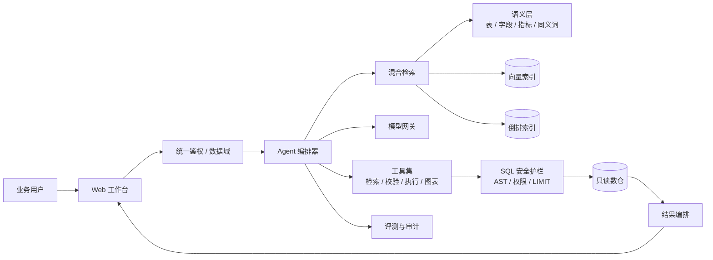

# 智能问数 Agent（NL2SQL）

> 让业务人员像问同事一样问数：说清楚问题，拿到文字、数据和图，而不是一张排队很久的取数单。

这是一个面向集团业务人员的 **B 端数据产品案例**。2026.03—2026.06，我在招商金科任 AI 产品经理，负责智能问数 Agent 的产品设计、语义层、基于 Claude Code 的 Agent 编排与灰度评测。业务人员原本平均要等 **6 小时**才能拿到一次临时取数结果；灰度后系统内查询链路缩短到 **30 秒级**，SQL 运行答案正确率 **85% 以上**。

> **作品集说明**
>
> - 这是作品集案例与交互演示，**不是生产系统代码仓库**；生产系统属于招商金科内部项目，代码、数据和账号不对外。演示使用**预置模拟数据**，不含真实客户、保单、机构、员工或业务数据。
> - 本目录只包含 5 份文档；交互演示在作品集站点内以静态 Mock 呈现，不需要数据库或模型 Key。
> - 另一个作品「面镜 MockMirror」是 C 端 AI 面试教练。本项目是 B 端数据产品，核心是 **Schema 理解、SQL 正确性、权限与安全、可评测**，不是陪伴式对话。

---

## 1. 项目定位

智能问数 Agent 不是「会写 SQL 的聊天框」，而是架在数仓、指标平台和 BI 之间的一层 **问数前置层**：

```text
业务问题 → 语义理解 / Schema Linking → 复杂度路由
        → SQL 生成 → 自查 → AST 校验 → 只读执行 → 文字 + 数据 + 图
```

它解决的不是「能不能生成 SQL」，而是三个更实际的问题：

1. **快**：把「提需求—排期—取数—校验」压缩成一次对话。
2. **准**：SQL 跑在正确的表、口径、时间范围上，并能解释数字怎么来的。
3. **稳**：只读、限流、脱敏、越权拦截，让自助不等于失控。

目标用户是集团内**有业务判断、但不会写 SQL** 的业务人员：业务分析师、条线经营管理人员、区域机构数据接口人。他们的问题高度碎片化，临时性远高于报表覆盖度，这正是 BI 覆盖不到、数据开发又被迫接单的部分。

---

## 2. 问题与切入点

改造前，一次临时取数的典型路径是：

```text
业务提需求 → 数据接口人转译 → 数据开发排期 → 写 SQL → 跑数 → 企微/邮件回传 → 业务复核
```

这条链路里，真正写 SQL 可能只要十分钟，**等待和来回澄清占了大头**。对业务来说，单次分析平均耗时约 6 小时；对数据开发来说，大量需求是重复的、口径相似的、只用一次的临时查询。双方都不满意。

通用 Chatbot 直接接数仓解决不了这件事：它不知道「保费收入」对应哪个口径，分不清签单日与生效日；会把相似表名张冠李戴，生成语法正确但业务错误的 SQL；没有权限概念；出错时只说「查询失败」，业务无法判断该不该信。

因此切入点不是换更强的模型，而是补上**企业语义资产**和**安全执行链路**：先把「表是什么、字段什么意思、指标怎么算、数据有什么坑」变成可检索的证据，再让模型在证据约束下生成 SQL，最后用确定性规则守住执行边界。

---

## 3. 功能清单

| # | 模块 | 用户看到什么 | 背后关键机制 |
| --- | --- | --- | --- |
| 1 | 登录与数据域 | 企业账号登录，只能看到授权范围内的数据 | 统一鉴权、数据域注入、行列权限、审计日志 |
| 2 | 对话问数工作台 | 输入自然语言，多轮追问，查看历史会话 | 会话状态、上下文压缩、指代消解 |
| 3 | 语义资产中心 | 表、字段、指标、同义词、数据质量说明 | 四层数据准备体系、语义卡片、版本管理 |
| 4 | 混合检索与 Schema Linking | 不需要感知，但结果里能看到引用了哪些表/指标 | 向量召回 + 倒排索引，RRF 融合、重排、证据拼装 |
| 5 | 复杂度路由与 Agent | 简单问题秒回，复杂问题展示分析步骤 | 规则特征 + 模型判定；few-shot / Decomposition+CoT / ReAct Loop |
| 6 | SQL 生成、校验与修复 | 展开可看 SQL、口径、假设和耗时 | 受约束生成、Query Checking、最多两轮 Repair |
| 7 | 安全与合规 | 高危请求被拒绝，敏感字段打码，导出留痕 | 只读账号、AST 解析、自动 LIMIT、脱敏、行级过滤 |
| 8 | 结果呈现 | 结论、数据表、图表、SQL、口径说明 | 结果编排、图表选型规则、数字只来自结果集 |
| 9 | 评测与反馈 | 点赞/点踩、报错、补充口径 | 评测集、错误归因、回归门禁、灰度看板 |

### 几个容易被追问的设计点

- **不是所有问题都走 Agent Loop。** 单表、单指标走 few-shot 单轮改写；只有跨表、多步、需要工具观察的问题才进 ReAct。路由错了，要么慢，要么错。
- **SQL 不直接执行。** 先过 Query Checker（语义、口径、时间、聚合），再过 AST 护栏，最后才进只读账号。
- **数字只来自结果集。** Composer 不允许「补一个大概的数」；没结果就说不确定，而不是编一个合理结论。
- **图表是结果的一部分。** 趋势折线、对比柱状、占比饼图；类别过多回退表格，避免误导。

---

## 4. 系统一览



一次典型问数分五步：**理解**（时间、指标、维度、对比关系）→ **找数**（混合检索 + Schema Linking）→ **生成**（按复杂度改写/分解/Agent）→ **校验**（Checker + AST + 只读执行）→ **表达**（结论、数据、图表、口径、SQL）。

更细的时序、状态机、数据模型和失败降级见 [architecture.md](architecture.md)。

---

## 5. 仓库与演示结构

本目录是作品集中的项目文档，不包含可执行的前后端代码：

```text
smart-query/
└── docs/
    ├── readme.md          # 项目总览与阅读入口
    ├── prd.md             # 需求、指标口径、功能与验收标准
    ├── architecture.md    # 架构、时序、安全、评测与数据模型
    ├── prompts.md         # 六类 Prompt 的输入输出、约束与成本
    └── demo.md            # 3 分钟 / 10 分钟演示脚本与追问应答
```

交互演示在作品集站点内，按以下逻辑组织：

```text
项目详情页
├── 场景选择：渠道保费 / 机构客户 / 退保分析
├── 对话区：预置问题 + 预置多轮追问
├── 执行轨迹：路由 → 检索证据 → SQL → 校验 → 结果
├── 安全沙盒：删除表、导出手机号等请求的拦截演示
└── 说明层：模拟数据标识、指标口径、能力边界
```

演示不执行真实 SQL，也不调用生产模型；它把关键状态和判断过程做成可点击的分支，让面试官看清 **产品是怎么想的**，而不是验证一个数据库连接。

---

## 6. 如何本地查看

**只看文档**：用任意 Markdown 阅读器打开本目录的 `readme.md`，或从作品集项目卡片进入。文档之间的链接均为相对路径，不需要启动服务。

**看交互演示**：在作品集仓库根目录启动站点：

```bash
pnpm install
pnpm start   # local: 3000
```

进入「智能问数 Agent」项目页。演示是前端静态 Mock，不需要数据库、模型 Key 或企业账号；「登录」是模拟态，不会上传真实身份。建议按 [demo.md](demo.md) 的 3 分钟脚本走一遍。

---

## 7. 关键指标

| 指标 | 口径 | 结果 | 状态 |
| --- | --- | --- | --- |
| SQL 答案正确率 | 灰度评测集上，SQL 执行结果与数据开发标注的标准结果一致（允许浮点误差、排序差异）；按题计分 | 稳定在 **85% 以上** | 已达成 |
| 单次业务分析周期 | 基线：业务提出需求到拿到可用结果，含排队与回传；产品：系统内从发送问题到返回结果，P50，不含人工复核 | **6 小时 → 30 秒** | 已达成（两个口径分母不同，见下） |
| 单次分析耗时降幅 | 业务侧自报的端到端耗时，含沟通、等待、复核；灰度有限样本 | 平均减少 **90%** | 已达成，样本待扩大 |
| 灰度接入范围 | 组织数据开发接入的真实 ETL 脚本与字段 | **10+ 个脚本、近千个字段** | 已达成 |
| 高危请求拦截率 | 既定安全用例中的 DDL/DML、多语句、越权、敏感字段明文请求被阻断的比例 | **100%**（确定性规则 + AST） | 已达成（规则覆盖内） |
| 任务完成率 | 有效提问中，最终获得可采纳结果（复制/导出/采纳/无重复改写）的会话占比 | ≥ 75% | 目标，试点验证中 |
| 自助率 | 无需数据开发介入即可完成的提问占比 | ≥ 60% | 目标/假设 |
| 端到端 P95 时延 | 发送问题到最终答案返回的 95 分位 | < 60 秒 | 目标 |

> **口径说明（面试会被追问）**
>
> 「6 小时 → 30 秒」比较的是**流程等待**和**系统链路**：6 小时含转译、排期、回传、复核；30 秒是系统生成并返回结果，不含人审。**90%** 是业务侧完整分析耗时的自报降幅，样本有限。三个数字必须带分母，否则像营销话术。

---

## 8. 关键设计取舍

1. **先做语义层，再调模型。** 同样的模型，喂不喂指标口径、表关系和脏数据，正确率差距远大于换模型。四层数据准备是地基，不是数据治理的附属工作。
2. **复杂度路由优先于统一 Agent。** 所有问题都跑 ReAct，简单问题会变慢、变贵，还容易过度分解；分流是成本、时延、正确率的平衡点。
3. **确定性护栏优先于提示词约束。** Prompt 里的「不要 DELETE」不够；AST、只读账号、自动 LIMIT 才是边界。
4. **证据优先于自由发挥。** 检索结果以 `[E1]…[En]` 注入，SQL 的表/字段必须可追溯；没证据就澄清或拒答。
5. **评测优先于感觉。** 改 Prompt、换模型、补语义卡都跑同一套回归；正确率、错误类型、时延、成本一起看。

---

## 9. 已知边界

- **覆盖范围决定上限。** 语义层没覆盖的长尾表、临时表、个人宽表，系统不会「大概猜一个」，而是提示暂不支持或转人工。
- **只读分析，不碰写操作。** 不做 ETL、不做数据修改、不做跨库同步；这是安全边界，不是能力缺陷。
- **复杂归因有限。** 「为什么退保率上升」能做的相关维度拆解和下钻，不做因果推断；答案里会明确写「相关，不代表因果」。
- **跨源 join 受限。** 不同数据域、刷新周期的表，join 前要确认粒度与时间口径；系统提示风险，必要时拒绝。
- **行级权限依赖组织映射。** 架构调整、兼岗、代管可能出现授权偏差，需要人工复核与定期对账。
- **数据新鲜度不可控。** 分区延迟、补数、口径变更都会影响结果；界面展示数据截止时间，但不保证实时。
- **评测集有分布偏差。** 85% 是灰度期业务问题分布下的结果，不代表所有问题类型；复杂多表、极端长尾会低于均值。
- **演示≠生产。** 交互演示是静态 Mock，用来讲清方案；生产系统的真实约束、性能和故障处理，以内部灰度记录为准。

---

## 10. 文档导航

- [产品需求文档](prd.md)：背景、竞品、指标口径、9 个功能模块、24 条 AC、灰度与风险。
- [架构说明](architecture.md)：整体架构、时序、复杂度路由、Schema Linking、检索、AST、评测、数据模型。
- [Prompt 设计](prompts.md)：六类 Prompt 的输入输出、约束、反例、预算、few-shot、降级与成本。
- [演示脚本](demo.md)：3 分钟 / 10 分钟版本、具体问题、逐步讲解、追问应答。

---

## 作者

石浩田 · 香港城市大学统计学硕士 · AI / 数据产品方向

2026.03—2026.06 于招商金科（央企金融科技平台）任 AI 产品经理，负责智能问数 Agent。这个案例展示的不是「我会写 Prompt」，而是如何把模型能力放进有语义、有权限、有评测的企业数据系统，产生业务价值。
